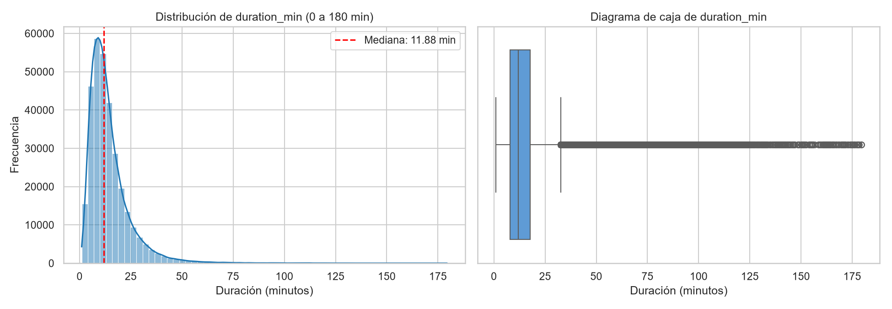
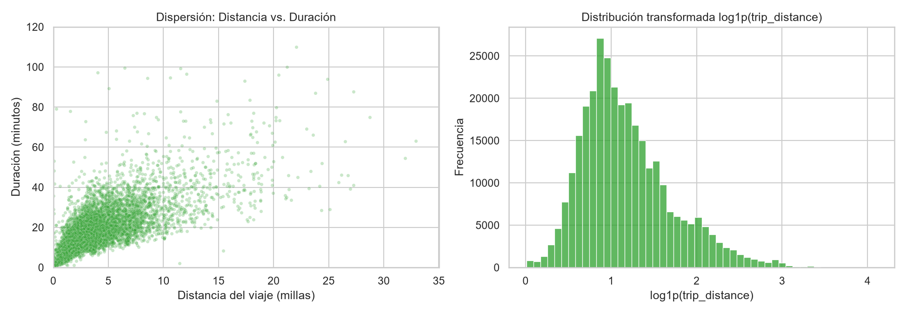
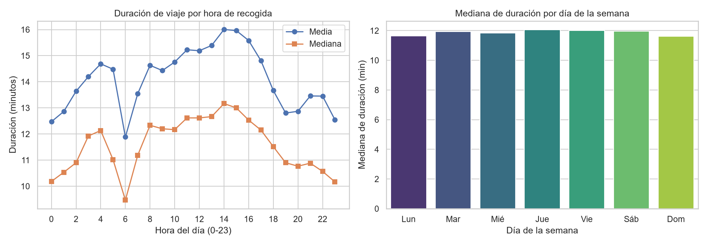
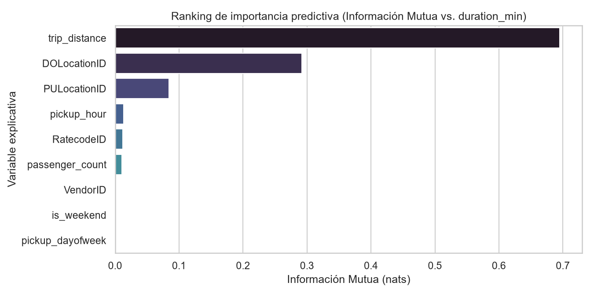
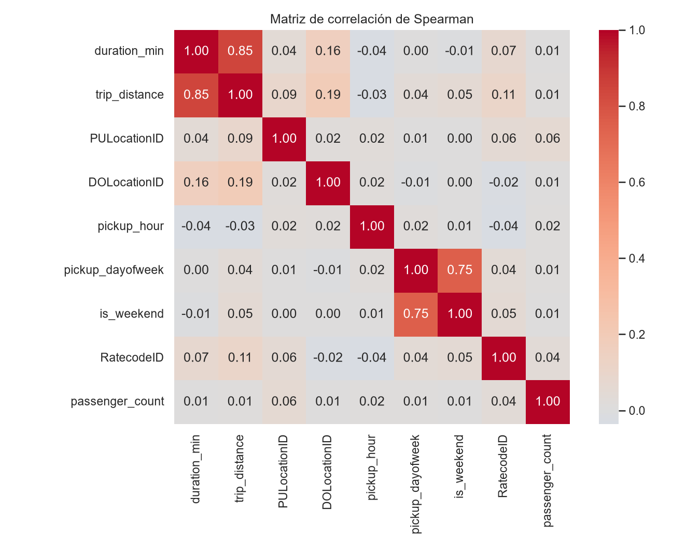

# Reporte de Datos

Este documento contiene los resultados del análisis exploratorio de datos (EDA) realizado sobre los registros de viajes de taxis verdes (*Green Taxis*) de Nueva York correspondientes al primer semestre de 2024 (enero a junio).

---

## Resumen general de los datos

* **Volumen inicial (crudo):** `339,807` observaciones distribuidas en 6 particiones mensuales y `20` variables originales, complementadas con un catálogo de `265` zonas geográficas TLC.
* **Volumen final procesado:** `315,128` observaciones válidas (`92.74%` de retención) y `13` variables seleccionadas sin fuga de información (*data leakage*).
* **Tipología de variables en el dataset limpio:**
  * **Variable objetivo continua (1):** `duration_min`.
  * **Variables numéricas (2):** `trip_distance`, `passenger_count`.
  * **Variables categóricas de alta y baja cardinalidad (6):** `PULocationID` (250+ zonas activas), `DOLocationID` (260+ zonas activas), `PU_Borough`, `DO_Borough`, `RatecodeID`, `VendorID`.
  * **Variables temporales derivadas (4):** `pickup_hour`, `pickup_dayofweek`, `is_weekend`, `pickup_month`.

### Estadísticas descriptivas globales (dataset limpio)

| Variable         |   count |   mean |   std |   min |   mediana |    max |
|:-----------------|--------:|-------:|------:|------:|----------:|-------:|
| duration_min     |  315128 |  14.44 | 10.83 |  1.02 |     11.88 | 179.47 |
| trip_distance    |  315128 |   2.82 |  2.8  |  0.01 |      1.93 |  59.89 |
| pickup_hour      |  315128 |  14.03 |  5.26 |  0    |     15    |  23    |
| pickup_dayofweek |  315128 |   2.89 |  1.91 |  0    |      3    |   6    |
| is_weekend       |  315128 |   0.24 |  0.43 |  0    |      0    |   1    |
| passenger_count  |  315128 |   1.31 |  0.97 |  0    |      1    |   9    |

---

## Resumen de calidad de los datos

Durante la auditoría sobre los `339,807` registros crudos se identificaron los siguientes hallazgos de calidad:

### 1. Valores faltantes en origen

| Columna              | Tipo    |   Nulos |   Porcentaje_Nulos |
|:---------------------|:--------|--------:|-------------------:|
| store_and_fwd_flag   | str     |   14219 |               4.18 |
| RatecodeID           | float64 |   14219 |               4.18 |
| passenger_count      | float64 |   14219 |               4.18 |
| ehail_fee            | float64 |  339807 |             100    |
| payment_type         | float64 |   14219 |               4.18 |
| trip_type            | float64 |   14268 |               4.2  |
| congestion_surcharge | float64 |   14219 |               4.18 |

### 2. Anomalías, valores extremos y duplicados detectados
* **Registros duplicados exactos:** `0` filas.
* **Errores de reloj del taxímetro (fechas fuera de ene–jun 2024):** `6` registros.
* **Duraciones inválidas o extremas ($\le 1$ min o $> 180$ min):** `11,624` registros.
* **Distancias inconsistentes ($\le 0$ millas o $> 100$ millas):** `17,908` registros.
* **Zonas desconocidas o fuera de NYC (`PULocationID`/`DOLocationID` en `264` o `265`):** `4,028` registros.

### 3. Acciones tomadas
1. **Exclusión de variables nulas o post-viaje:** Se eliminó `ehail_fee` (100% nula) y todas las variables financieras/de cierre (`fare_amount`, `total_amount`, `lpep_dropoff_datetime`, etc.) para evitar fuga de información.
2. **Filtrado de integridad física:** Se descartaron `24,679` registros (`7.26%`) que incumplían los rangos operativos de fecha, duración, distancia o zona válida.
3. **Imputación determinista:** Los `14,219` valores faltantes (`4.18%`) en `passenger_count` y `RatecodeID` se imputaron con la mediana (`1.0` pasajero) y la tarifa estándar (`1`), respectivamente.

---

## Variable objetivo

La variable objetivo **`duration_min`** representa el tiempo transcurrido en minutos entre `lpep_pickup_datetime` y `lpep_dropoff_datetime`.

| Métrica              | Valor      |
|:---------------------|:-----------|
| Conteo               | 315,128    |
| Media                | 14.44 min  |
| Desviación estándar  | 10.83 min  |
| Mínimo               | 1.02 min   |
| Percentil 25 (Q1)    | 7.83 min   |
| Mediana (Q2)         | 11.88 min  |
| Percentil 75 (Q3)    | 17.75 min  |
| Percentil 95         | 33.10 min  |
| Máximo               | 179.47 min |
| Asimetría (Skewness) | 3.52       |

* **Interpretación:** Presenta una distribución unimodal con marcada **asimetría positiva (cola larga hacia la derecha)**, donde la media supera a la mediana debido a trayectos largos hacia aeropuertos o entre distritos congestionados. Esto justifica evaluar los modelos futuros con **MAE** (robusto a colas largas) junto con **RMSE**.

---

## Variables individuales

### 1. Distancia del viaje (`trip_distance`)
* Presenta alta asimetría positiva (mediana cercana a 1.8–2.0 millas con viajes de hasta 100 millas).
* **Transformación recomendada:** Aplicar `log1p(trip_distance)` y estandarización (`StandardScaler`) para estabilizar la varianza en modelos lineales y redes neuronales.

### 2. Variables temporales (`pickup_hour`, `pickup_dayofweek`, `is_weekend`)
* La duración media y mediana aumenta significativamente durante las **horas pico laborales (08:00–09:00 y 15:00–18:00)** debido a la congestión vehicular, y disminuye en horas de madrugada (01:00–05:00) y fines de semana.
* **Transformación recomendada:** Codificación cíclica ($\sin/\cos$) para `pickup_hour` y `pickup_dayofweek` en arquitecturas neuronales, o uso directo como enteros en modelos basados en árboles.

### 3. Variables espaciales (`PULocationID`, `DOLocationID`, `PU_Borough`, `DO_Borough`)
* Alta cardinalidad (`> 250` zonas activas). La operación de taxis verdes se concentra mayoritariamente en Manhattan (zona norte), Queens y Brooklyn.
* **Transformación recomendada:** Uso de capas de **Embeddings densos** para `PULocationID` y `DOLocationID` en la red neuronal, y *Target Encoding* o agrupamiento por frecuencia en modelos tabulares clásicos.

#### Distribución por distrito de origen (`PU_Borough`)

| PU_Borough    |   Viajes |   Media_min |   Mediana_min |
|:--------------|---------:|------------:|--------------:|
| Manhattan     |   192474 |       13.21 |         11.28 |
| Queens        |    77447 |       15.01 |         11.78 |
| Brooklyn      |    41986 |       18.64 |         15.37 |
| Bronx         |     3208 |       18.82 |         15    |
| Staten Island |       13 |       26.79 |         21.52 |

---

## Ranking de variables

Para cuantificar la capacidad predictiva individual (capturando tanto relaciones lineales como no lineales) se calculó la **Información Mutua (*Mutual Information*)** y la **correlación absoluta de Spearman** respecto a `duration_min`:

| Variable         |   Mutual_Information |   Corr_Spearman_Abs |
|:-----------------|---------------------:|--------------------:|
| trip_distance    |               0.6953 |              0.8481 |
| DOLocationID     |               0.2917 |              0.1629 |
| PULocationID     |               0.0842 |              0.0436 |
| pickup_hour      |               0.0132 |              0.0361 |
| RatecodeID       |               0.0118 |              0.0741 |
| passenger_count  |               0.0107 |              0.0074 |
| VendorID         |               0.0014 |              0.0016 |
| is_weekend       |               0      |              0.0116 |
| pickup_dayofweek |               0      |              0.0014 |

* **Hallazgo clave:** `trip_distance` domina la capacidad explicativa, seguida por las zonas específicas de destino y origen (`DOLocationID`, `PULocationID`) y la franja horaria (`pickup_hour`), confirmando que combinar distancia con representación espacial y temporal es esencial para predecir el ETA.

---

## Relación entre variables explicativas y variable objetivo

* **Relación distancia–tiempo:** Existe una fuerte correlación monótona positiva entre `trip_distance` y `duration_min`; sin embargo, la dispersión vertical crece a medida que aumenta la distancia, reflejando el impacto de la velocidad variable según la hora del día y el corredor vial.
* **Interacción espacio-temporal:** Trayectos de igual distancia presentan tiempos sustancialmente distintos dependiendo de si ocurren en horas pico entre distritos (`pickup_hour` $\times$ `PULocationID` / `DOLocationID`), lo que respalda el uso de modelos no lineales (ensambles de árboles y MLP con *Embeddings*) frente a una regresión lineal simple.
